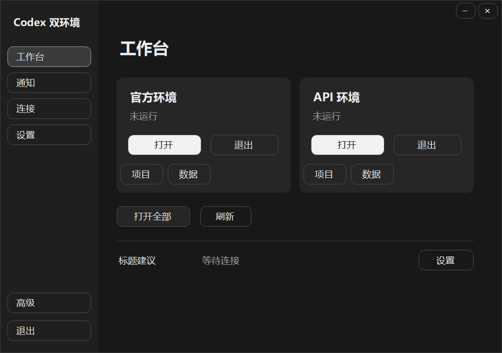
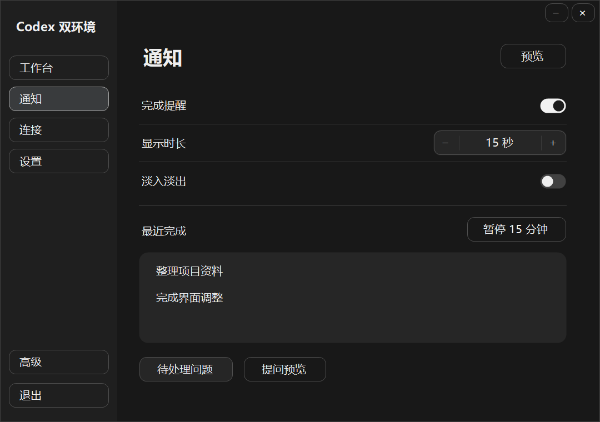
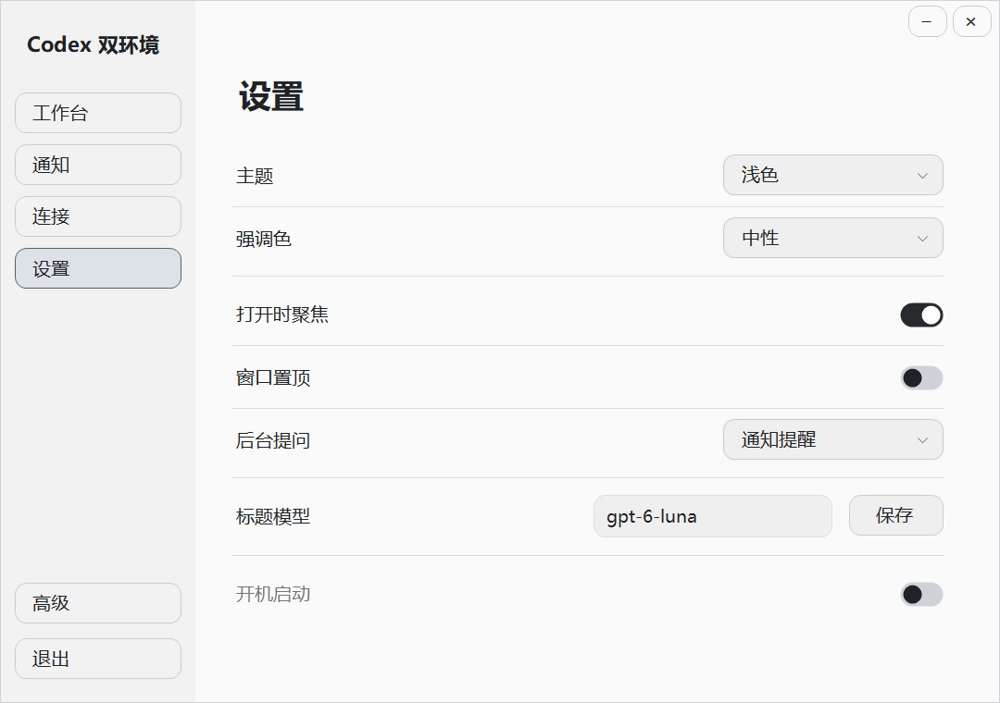
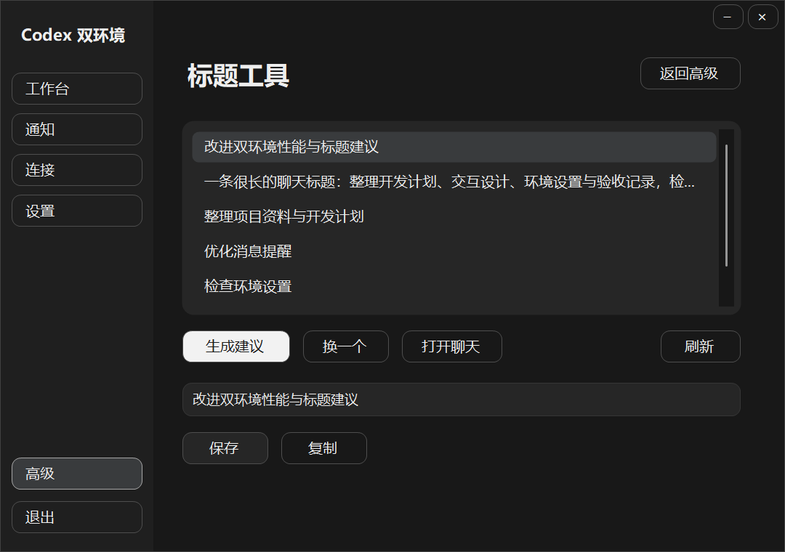

# Codex Desktop 双环境

**在 Windows 上同时使用官方订阅与自选 API，用一个控制器管理两套独立的 Codex Desktop 环境。**

[下载 C# 预览版](https://github.com/hc568871650-commits/codex-desktop-dual-environment/releases/tag/v0.9.0-preview.4) · [下载稳定版](https://github.com/hc568871650-commits/codex-desktop-dual-environment/releases/latest) · [安装与回退](docs/DOTNET-INSTALL.md) · [更新说明](docs/RELEASE-0.9.0-preview.4.md)

当前预览版本为 **0.9.0-preview.4**：主程序迁移至 C# / .NET 10，公开包自带运行时，支持首次安装、从 0.8.9 升级、回退和卸载。稳定版仍为 **0.8.9**；本页介绍与配图均对应新的 C# 预览版。



*本页四张图片均由本版本真实 WinForms 控件生成，使用隔离配置和合成内容，不含真实聊天或凭据。图中的状态用于展示布局，不是日常实例的运行状态。[配图来源与复现方法](docs/images/0.9/README.md)。*

## 一个面板，管理两套环境

两套 Desktop 分别使用自己的 home、profile 和凭据入口，可以同时打开。控制器负责启动、找回窗口、管理 API 渠道和显示 API 任务提醒；任务由你分配给各窗口。

| 页面 | 能做什么 |
|---|---|
| 工作台 | 分别打开、定位和退出官方/API 环境，访问项目与数据目录 |
| 通知 | 管理完成提醒、显示时长、淡入淡出与暂停，查看最近完成记录 |
| 连接 | 管理托管 API 渠道，切换配置、备份与恢复；外部环境沿用原管理工具 |
| 设置 | 深浅主题、强调色、聚焦与置顶、后台提问偏好、标题模型和开机启动 |
| 高级 | 查看组件诊断、日志，进入可选标题工具与凭据设置 |

控制器按 EXE 路径、home/profile、PID 和创建时间核验实例。退出实例前需要确认；关闭面板只收起到托盘，退出控制器不会结束两套 Codex。

独立配置不等于文件沙箱。两个进程仍具有当前 Windows 用户的文件权限；同时修改同一项目时，建议使用不同目录或 Git worktree。本工具不会自动分派任务或同步聊天。

## 通知集中在一页

完成提醒与最近完成列表面向**已登记的 API 实例**。后台监测合入 C# 控制器，使用文件变化监听、有界读取和低频补扫，保留历史去重与重启续读；超长附件行不会阻断后续完成事件。



可设置提醒时长、淡入淡出或暂停 15 分钟。已核验的 API 主窗口位于前台时，自动完成提示保持静默，完成记录仍更新；这里按实例判断，不代表逐个聊天标签页的前台状态。

“待处理问题”和“提问预览”是界面入口。**公共包不安装提问代理，也不自动接管原生问题。** 外部提问桥接仍为独立实验，需要单独配置与核验；连接失败时应使用 Codex 原生作答入口。

## 深浅主题与常用偏好

主导航精简为工作台、通知、连接和设置。界面增大字体与点击区域，统一圆角、按钮边框和分隔线，支持深色、浅色及跟随系统。



preview.4 修复了下拉菜单关闭后访问已释放对象的问题，也修复了较小窗口中页头操作超出可点击区域的问题。小屏幕下部分内容通过滚动访问。

## 可选的标题建议

标题适配会发现经过核验的官方 CLI，先通过临时环境和回环服务做兼容检查，再允许生成标题。生成沿用 API 渠道配置；模型权限和费用由实际服务商决定。



上图是**独立标题工具**，不是 Codex 原生重命名弹窗。原生弹窗适配保留用户采用、手动编辑和保存步骤；独立工具的保存通过原生协议写回并回读核对，不直接修改聊天数据库。

首次安装默认关闭标题挂接，升级保留已有明确设置。托管环境和外部启动器的启用、停用方法不同，见[标题接入说明](docs/DOTNET-INSTALL.md#标题建议可选实验功能)。原生弹窗完整交互与所有上游版本尚未全面验收，不能承诺未来更新自动兼容。

## 安装与升级

要求：**Windows x64、Windows PowerShell 5.1、已安装的 Codex Desktop**。公开 ZIP 自带 .NET 10 Desktop 运行时，日常使用无需额外安装 .NET SDK、Node.js 或 Python。ARM64 与 32 位未支持。

1. 下载 `CodexDualController-0.9.0-preview.4-win-x64.zip` 和 `SHA256SUMS.txt`，核对 SHA-256 后解压到独立目录。
2. **新用户**运行 `Install.cmd`，选择一个空工具目录，按提示填写官方 `CODEX_HOME`、API 地址、模型 ID 和密钥。密钥隐藏输入，由当前 Windows 用户的 DPAPI 加密保存。
3. **已有用户**先从托盘退出控制器，再运行新包中的 `Upgrade.cmd`，输入原工具的实际安装目录。Codex 可以继续运行；不要把 ZIP 直接覆盖到旧安装，也不要选择数据目录或目录联接。
4. 升级会在工具目录旁创建独立备份并打印 `receipt.json` 路径。保留整份备份，之后可按[回退说明](docs/DOTNET-INSTALL.md#回退与卸载)恢复升级前的工具文件。

首次安装默认工具目录为 `%LOCALAPPDATA%\CodexDualController`，API 数据位于 `%LOCALAPPDATA%\CodexDualData\API`。官方数据保持原位，不复制官方认证或聊天。安装器需要能解析已有官方配置中的 `[desktop] projectlessWorkspaceRoot`，遇到缺失或复杂写法会提示处理。

同一个 ZIP 同时支持首次安装与升级。安装器拒绝覆盖修改过或未登记的工具文件；卸载按清单删除未修改工具与原位置快捷方式，保留配置、凭据、聊天、状态、备份和用户修改。

| 日常入口 | 操作 |
|---|---|
| Codex Dual Controller 快捷方式 | 打开控制面板 |
| Codex Official / Codex API 快捷方式 | 打开对应环境 |
| 托盘单击 / 双击 | 打开 API 环境 / 打开面板 |
| 托盘右键 | 常用操作与退出控制器 |
| 面板右上角 × | 收起到托盘 |

完整安装参数、外部启动器接入、回退和卸载步骤见[预览版安装指南](docs/DOTNET-INSTALL.md)。如果继续使用 0.8.9，请参考 [0.8.9 文档](https://github.com/hc568871650-commits/codex-desktop-dual-environment/tree/v0.8.9#readme)。

## 验证范围

本次发布检查覆盖 22 项 C# 核心测试、20 个标题前端隔离场景、25 项安装包验收、32 套旧控制器回归及桥接 fixture 检查。安装包验收包括中文和空格路径、深浅主题、最小窗口尺寸、菜单反复选择、公开 0.8.9 升级基线、配置与凭据保留、逐文件回退和卸载。

这些检查使用隔离数据和合成输入，不等同于所有日常工作流都已验证。自然任务完成提醒、跨窗口/前后台全部组合、原生标题弹窗完整交互和长期稳定性仍需实际使用反馈。构建仍有旧控件及兼容代码的 nullable 警告；性能历史数据不作为固定内存或整体提速承诺。

[查看 CI](https://github.com/hc568871650-commits/codex-desktop-dual-environment/actions/workflows/test.yml) · [查看发布记录与附件校验](https://github.com/hc568871650-commits/codex-desktop-dual-environment/releases/tag/v0.9.0-preview.4)

## 从源码构建

安装 .NET 10 SDK 后，在仓库根目录执行：

```powershell
# 先跑核心检查，再生成自包含 ZIP 与 SHA256SUMS.txt；输出目录必须是新的
powershell.exe -NoProfile -ExecutionPolicy Bypass -File scripts\Build-DotNetRelease.ps1 -OutputDirectory 'C:\Build\CodexDual-preview4'
```

版本以根 `version.json` 为准。C# 主程序不再加载 PowerShell Runspace，安装、维护及部分旧外部启动器仍使用 PowerShell。旧 `Build-Release.ps1` / `Build-UpgradePackage.ps1` 仅用于 0.8.x 兼容流程，不用于发布本 C# 预览版。

| 版本 | 主要变化 |
|---|---|
| [0.9.0-preview.4](docs/RELEASE-0.9.0-preview.4.md) | C# 控制器、自包含分发、通知读取改进、新界面、安装升级与回退 |
| [0.8.9 稳定版](https://github.com/hc568871650-commits/codex-desktop-dual-environment/releases/tag/v0.8.9) | 一次确认退出、组件诊断、安全登记刷新和隐藏草稿保护 |
| [历史版本](https://github.com/hc568871650-commits/codex-desktop-dual-environment/releases) | 主题、通知、渠道管理与双环境启动能力的迭代 |
